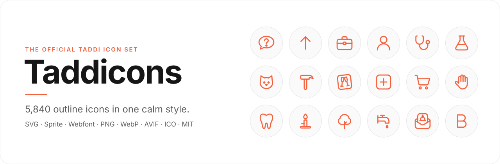

<p align="center">
  <a href="https://taddicons.com">
    <picture>
      <source media="(prefers-color-scheme: dark)" srcset="assets/taddicons-logo-light.png">
      
    </picture>
  </a>
</p>

<p align="center">
  <a href="https://taddicons.com">
    <picture>
      <source media="(prefers-color-scheme: dark)" srcset="assets/banner-dark.svg">
      
    </picture>
  </a>
</p>

<p align="center">
  <b><!-- count -->5,840<!-- /count --> outline icons in one calm style.</b><br>
  Every interface symbol, an icon for every kind of document people write, and the specialist icons other sets leave out,<br>
  from lab glassware and dental tools to plumbing valves and sailing knots. Drawn by hand, free under the MIT License.
</p>

<p align="center">
  <a href="https://taddicons.com"></a>
  <a href="#formats"></a>
  <a href="CHANGELOG.md"></a>
  <a href="LICENSE"></a>
</p>

<p align="center">
  <a href="https://taddicons.com"><b>Website</b></a> ·
  <a href="#gallery">Gallery</a> ·
  <a href="#quick-start">Quick start</a> ·
  <a href="#formats">Formats</a> ·
  <a href="#webfont">Webfont</a> ·
  <a href="#style-guide">Style guide</a> ·
  <a href="#metadata">Metadata</a> ·
  <a href="LICENSE">License</a>
</p>

---

## Why Taddicons

Taddicons started as one icon for every kind of document [Taddi](https://taddi.app) writes (a "Tad"). Version 2 grows
it into a complete icon set: the interface icons every app needs, and thousands of specialist icons for the work and
life people actually write about.

- **<!-- count -->5,840<!-- /count --> icons in <!-- categories-count -->79<!-- /categories-count --> categories, in eight sections.** Documents and messages; interface (arrows, controls,
  text, files, communication, devices, media, design, code, charts, security, time, shapes, maths); business (office,
  commerce, finance, logistics, property); people (people, hands, accessibility, emoji, celebrations, faith, society);
  everyday life (health, dental, veterinary, beauty, baby, household, kitchen, food, clothing, education); science and
  leisure (science, the lab, sports, games, instruments, photography); the world (animals, nature, the outdoors,
  gardening, farming, weather, energy, transport, aviation, maritime, maps, buildings); and making things (tools, the
  trades, electronics, industry, crafts).
- **One style throughout.** A 24 px grid, a thin 1.35 line (never a hairline), round caps and joins, soft corners and
  warm, simple shapes. Calm and friendly, never cartoonish or technical.
- **Families you can read.** Cards are a card set down at a slight angle, invitations a card rising from an envelope,
  social posts a rounded square, and formal documents a page with a folded corner. The picture inside tells you the topic.
- **Every format you need.** SVG files in three colourings, an SVG sprite, a webfont with CSS classes and ligatures, and
  PNG, WebP, AVIF and ICO files in five sizes (in the [release downloads](https://github.com/taddicons/icons/releases/tag/v2.0.1)).
- **Made to be found.** Every icon has a section, a category and search keywords in [`icons.json`](icons.json); the
  document icons also have a frequency tier, a document kind and the channels they are sent on.
- **Free.** MIT licensed, for personal and commercial work.

## Quick start

### SVG files

Copy the icon you need from [`svg/outline`](svg/outline). The outline icons use `currentColor`, so they take the
colour of the text around them when you place them inline.

```html
<!-- As an image -->


<!-- Inline: the icon takes the text colour -->
<button class="btn">
  <svg width="20" height="20" viewBox="0 0 24 24" fill="none" stroke="currentColor" stroke-width="1.35"
       stroke-linecap="round" stroke-linejoin="round" aria-hidden="true">…paths from the file…</svg>
  New birthday card
</button>
```

### SVG sprite

One request for all <!-- count -->5,840<!-- /count --> icons. Each icon is a `<symbol>` with the icon's name as its id; the line style comes from the
`<svg>` that uses it, so you can change colour and weight with CSS.

```html
<svg width="24" height="24" fill="none" stroke="currentColor" stroke-width="1.35"
     stroke-linecap="round" stroke-linejoin="round" aria-hidden="true">
  <use href="/sprite/taddicons.svg#refund-request"/>
</svg>
```

### Webfont

```html
<link rel="stylesheet" href="https://cdn.jsdelivr.net/gh/taddicons/icons@2.0.1/font/taddicons.min.css">

<i class="ti ti-wedding-invitation"></i>
<i class="ti ti-2x ti-gradient ti-thank-you-note"></i>
<i class="ti ti-mark ti-cover-letter"></i>
```

### Images and favicons

The SVGs work as images anywhere, in two ready-made colourings besides the outline: `gradient` (the lines in the Taddi
gradient on a transparent background) and `mark` (the official mark: the gradient icon on a light circle):

```html

```

PNG, WebP and AVIF at 32 to 512 px and an ICO for every icon are in the [release downloads](https://github.com/taddicons/icons/releases/tag/v2.0.1), one ZIP per format,
sorted as `<format>/<colouring>/<size>/<name>.<ext>`.

Every file in this repository is on the jsDelivr CDN at
`https://cdn.jsdelivr.net/gh/taddicons/icons@2.0.1/<path>`, for example `.../svg/outline/lease-agreement.svg`.

## Formats

| Folder | Format | Colouring | Sizes | Best for |
|---|---|---|---|---|
| [`svg/outline`](svg/outline) | SVG | `currentColor` lines | scalable, 24 px grid | Websites and apps; any colour through CSS |
| [`svg/gradient`](svg/gradient) | SVG | Taddi gradient lines, transparent | scalable | Design tools, presentations |
| [`svg/mark`](svg/mark) | SVG | Gradient icon on the light circle | scalable, 40 px grid | Avatars, list markers, docs |
| [`sprite`](sprite) | SVG sprite | from the page | scalable | Many icons on one page with one request |
| [`font`](font) | WOFF2, WOFF, TTF, CSS, SCSS, JSON | text colour, or the gradient helpers | scalable | `<i class="ti ti-…">`, ligatures |
| [Release](https://github.com/taddicons/icons/releases/tag/v2.0.1) `png` | PNG | `gradient`, `mark` | 32, 64, 128, 256, 512 | Email, documents, anything without SVG |
| [Release](https://github.com/taddicons/icons/releases/tag/v2.0.1) `webp` | WebP (lossless) | `gradient`, `mark` | 32, 64, 128, 256, 512 | Small files for the web |
| [Release](https://github.com/taddicons/icons/releases/tag/v2.0.1) `avif` | AVIF | `gradient`, `mark` | 32, 64, 128, 256, 512 | The smallest files for modern browsers |
| [Release](https://github.com/taddicons/icons/releases/tag/v2.0.1) `ico` | ICO (PNG frames) | `mark` | 16, 24, 32, 48, 64, 128, 256 in one file | Favicons, Windows |
| [`icons.json`](icons.json) | JSON | | | Names, titles, sections, categories, keywords, code points |
| [`gallery`](gallery) | Markdown, HTML | | | One page per category, and the whole set on one searchable page |

With <!-- count -->5,840<!-- /count --> icons the raster files (about a gigabyte) no longer live in the repository: each format is one ZIP in the
[release downloads](https://github.com/taddicons/icons/releases/tag/v2.0.1), sorted as `<format>/<colouring>/<size>/<name>.<ext>`:

```
taddicons/
├── svg/
│   ├── outline/        one .svg per icon, currentColor
│   ├── gradient/       one .svg per icon
│   └── mark/           one .svg per icon
├── sprite/taddicons.svg
├── font/               taddicons.woff2 · .woff · .ttf · .css · .min.css · .scss · .json · demo.html
├── gallery/          <category>.md pages and index.html, the whole set
├── icons.json          metadata
└── scripts/            the build

release downloads (one ZIP each):
├── png/
│   ├── gradient/       32/ 64/ 128/ 256/ 512/
│   └── mark/           32/ 64/ 128/ 256/ 512/
├── webp/               same layout as png/
├── avif/               same layout as png/
└── ico/                one .ico per icon
```

## Webfont

The font is in [`font`](font). Load `taddicons.css` (or `taddicons.min.css`) and the font files next to it.

```html
<i class="ti ti-apology-letter" aria-hidden="true"></i>
```

| Class | What it does |
|---|---|
| `ti` | Base class, always needed |
| `ti-<name>` | The icon, for example `ti-job-application` |
| `ti-xs` `ti-sm` `ti-lg` `ti-xl` | 0.75, 0.875, 1.25 and 1.5 times the text size |
| `ti-2x` … `ti-10x` | 2 to 10 times the text size |
| `ti-fw` | Fixed width, so icons line up in lists and menus |
| `ti-rotate-90` `ti-rotate-180` `ti-rotate-270` | Rotate |
| `ti-flip-h` `ti-flip-v` `ti-flip-both` | Mirror |
| `ti-gradient` | The lines in the Taddi button gradient |
| `ti-mark` | The official mark: the gradient icon on a light circle |
| `ti-ul` + `ti-li` | Icons as list bullets |

**Ligatures.** The font knows every icon's name, so the name written as text turns into the icon:

```html
<span class="ti">birthday-card</span>
```

**Code points.** Icons sit in the Private Use Area from `U+E001`, in catalog order. The full map is in
[`font/taddicons.json`](font/taddicons.json) and as a Sass map in [`font/taddicons.scss`](font/taddicons.scss):

```scss
@use "taddicons" as ti;
.receipt::before { font-family: ti.$font-family; content: map-get(ti.$icons, "refund-request"); }
```

The font's line is drawn at 1.5 on the 24 grid (the SVGs use 1.35), so it stays crisp at 14 to 16 px. Open
[`font/demo.html`](font/demo.html) to see every glyph. With forced colours (Windows high contrast) the gradient
helpers fall back to the system text colour.

## Using it in an app

**React, with the sprite**

```jsx
export function Taddicon({ name, size = 24, label }) {
  return (
    <svg width={size} height={size} fill="none" stroke="currentColor" strokeLinecap="round" strokeLinejoin="round"
         strokeWidth={Math.max(1.35, 24 / size)} role={label ? "img" : undefined}
         aria-label={label} aria-hidden={label ? undefined : true}>
      <use href={`/taddicons.svg#${name}`} />
    </svg>
  );
}
```

**Any bundler, with the SVG files**: import `svg/outline/<name>.svg` with your SVG loader (SVGR, vite-svg-loader, …).

**Install from GitHub**

```sh
npm install github:taddicons/icons
```

## Message emoji

Every icon also comes as a message emoji: a white sticker (the shape filled and edged in white) with the lines in the
Taddi gradient. It reads on light, coloured and dark chat bubbles alike. Taddi uses these in its messages.

| File | What it is |
|---|---|
| `svg/emoji/<name>.svg` | One emoji, viewBox `-3 -3 30 30`, no shadow (add your own, for example a 0.5 px drop shadow) |
| `sprite/taddicons-emoji.svg` | Every emoji as a `<symbol>`, sharing one gradient. Inline it in the page and use `<svg width="28" height="28"><use href="#face-smile"/></svg>` |
| `emoji.json` | The picker groups (faces, hands, people, celebrations, food, animals, nature, travel, activities, objects, Taddi), and per emoji its title, keywords and the standard emoji it stands for when there is one |
| Release `png` / `webp` `emoji/` | 32, 64, 96 and 144 px with a soft shadow, for notifications and emails |

A message stores an emoji as a short code, `:face-tears-of-joy:`. Where the sticker cannot be shown, use the `unicode`
field from `emoji.json` (😂), or the title.

## Style guide

| | |
|---|---|
| Grid | 24 × 24, drawn inside 2 to 22 |
| Line | 1.35 on the grid, round caps, round joins, no fills |
| Smallest line | 1 px on screen: for an icon drawn `s` px wide use `stroke-width = max(1.35, 24 / s)` |
| Best sizes | 16, 20, 24, 32, 48 px |
| Gradient | `#f76845` → `#f25e3a`, left to right (`oklch(70.66% 0.1785 34.6)` → `oklch(66.88% 0.1894 34.86)`) |
| Mark | Circle `#fafafa` (`lab(98.27 0 0)`), faint edge `#e4e4e4` (`lab(90.5 0 0)`), icon at 60% of the circle |

**Accessibility.** An icon next to a text label is decoration: give it `aria-hidden="true"`. An icon on its own needs
a name: `role="img"` and `aria-label="…"` on the `<svg>`, or `alt` on the ``. Keep icon buttons at least 24 px
(44 px on touch screens) and keep the line colour at 3:1 contrast or more against its background.

## Categories

<!-- categories:start -->
### Documents & messages

One icon for every kind of document Taddi writes. 400 icons.

| | Category | Icons | What it covers |
|:-:|---|--:|---|
|  | [Everyday messages](gallery/messages.md) | 23 | Quick notes, replies and emails for the day-to-day. |
|  | [Cards and greetings](gallery/cards.md) | 31 | Designed digital cards for every occasion, sent as a link or printed. |
|  | [Invitations and events](gallery/invitations.md) | 32 | Designed invitations with their own RSVP page, plus every message around an event. |
|  | [Social posts](gallery/social.md) | 26 | Posts with a picture for the networks you connected, written for regular people, not influencers. |
|  | [Life events and speeches](gallery/life.md) | 30 | Announcements, letters and the words for the big moments. |
|  | [Family and home](gallery/family.md) | 20 | Notes, plans and instructions that keep a household running. |
|  | [Letters to companies](gallery/consumer.md) | 32 | Complaints, refunds, cancellations and your consumer rights, done properly. |
|  | [Money and bills](gallery/money.md) | 19 | Invoices, reminders, payment plans, claims and money between friends. |
|  | [Home and renting](gallery/housing.md) | 18 | Landlords, tenants, neighbours and moving. |
|  | [Work and jobs](gallery/work.md) | 35 | Applications, requests and messages at work. |
|  | [Small business and side hustle](gallery/business.md) | 25 | Everything a small shop, freelancer or club treasurer sends to customers. |
|  | [Buy and sell](gallery/selling.md) | 10 | Listings and messages for selling and buying things online. |
|  | [School and learning](gallery/school.md) | 17 | For students, parents and teachers. |
|  | [Health and care](gallery/health.md) | 16 | Doctors, records, insurance and caring for someone. |
|  | [Government and official](gallery/government.md) | 19 | Authorities, appeals, permits and your representatives. |
|  | [Agreements and legal](gallery/legal.md) | 19 | Simple agreements, consents and formal notices; complex matters go to a lawyer. |
|  | [Community and clubs](gallery/community.md) | 16 | Clubs, teams, neighbours, volunteers and causes. |
|  | [Travel](gallery/travel.md) | 12 | Bookings, hosts, plans and postcards. |

### Interface

Arrows, controls, files, media, code and the symbols of every app. 1,957 icons.

| | Category | Icons | What it covers |
|:-:|---|--:|---|
|  | [Arrows & directions](gallery/arrows.md) | 189 | Arrows, chevrons, turns, swaps and every way to point. |
|  | [Interface & controls](gallery/interface.md) | 292 | Menus, views, toggles, states, alerts and window chrome. |
|  | [Text & editing](gallery/text.md) | 104 | Formatting, alignment, lists, headings and writing tools. |
|  | [Letters, numbers & punctuation](gallery/alphabet.md) | 110 | A to Z, 0 to 9 and the marks between them. |
|  | [Files & folders](gallery/files.md) | 186 | Files, folders, archives and storage. |
|  | [Communication](gallery/communication.md) | 108 | Chat, mail, calls, contacts and announcements. |
|  | [Devices & hardware](gallery/devices.md) | 105 | Computers, phones, peripherals, parts and power. |
|  | [Network & cloud](gallery/connectivity.md) | 82 | Wi-Fi, signal, cloud, servers, databases and links. |
|  | [Media & playback](gallery/media.md) | 191 | Playback, audio, music, photo, video and film. |
|  | [Design & creative](gallery/design.md) | 106 | Drawing tools, layers, alignment, colour and shapes tools. |
|  | [Code & development](gallery/code.md) | 104 | Code, terminals, version control, builds and bots. |
|  | [Charts & data](gallery/charts.md) | 99 | Charts, dashboards, diagrams and analytics. |
|  | [Security & privacy](gallery/security.md) | 94 | Shields, locks, keys, identity and protection. |
|  | [Time & calendar](gallery/time.md) | 79 | Clocks, timers, calendars and schedules. |
|  | [Shapes & symbols](gallery/shapes.md) | 54 | Geometric shapes, solids, badges and common symbols. |
|  | [Math](gallery/math.md) | 54 | Operators, functions, geometry and set notation. |

### Business & money

Offices, shops, payments, shipping and property. 405 icons.

| | Category | Icons | What it covers |
|:-:|---|--:|---|
|  | [Office & business](gallery/office.md) | 101 | Work, meetings, desks, goals, hiring and support. |
|  | [Shopping & commerce](gallery/commerce.md) | 107 | Carts, bags, stores, tags, coupons and orders. |
|  | [Money & finance](gallery/finance.md) | 106 | Coins, cards, banks, currencies, savings and taxes. |
|  | [Logistics & moving](gallery/logistics.md) | 66 | Boxes, pallets, warehouses, delivery and moving. |
|  | [Property & legal](gallery/property.md) | 25 | Homes for sale or rent, plans, contracts and courts. |

### People & society

People, hands, feelings, access, faith and celebrations. 485 icons.

| | Category | Icons | What it covers |
|:-:|---|--:|---|
|  | [People & users](gallery/people.md) | 112 | Users, groups, roles, figures and actions. |
|  | [Hands & gestures](gallery/hands.md) | 61 | Hands, signs and gestures. |
|  | [Accessibility](gallery/accessibility.md) | 47 | Access, mobility, vision, hearing and assistance. |
|  | [Emoji & feelings](gallery/emoji.md) | 89 | Faces, moods and reactions. |
|  | [Holidays & celebrations](gallery/celebrations.md) | 67 | Parties, gifts, seasons and festivities. |
|  | [Faith & spirituality](gallery/faith.md) | 34 | Symbols and places of faith, drawn with respect. |
|  | [Society & causes](gallery/society.md) | 75 | Charity, civic life, voting, rights and relief. |

### Everyday life & health

Health, home, kitchen, food, clothing, care and school. 868 icons.

| | Category | Icons | What it covers |
|:-:|---|--:|---|
|  | [Medical & health](gallery/medical.md) | 176 | Care, medicine, the body, tests and specialties. |
|  | [Dental care](gallery/dental.md) | 34 | Teeth, treatments and the dentist's tools. |
|  | [Veterinary care](gallery/veterinary.md) | 23 | Care for pets and farm animals. |
|  | [Beauty & wellness](gallery/beauty.md) | 31 | Salon, skin care, make-up and spa. |
|  | [Baby & kids care](gallery/baby.md) | 25 | Bottles, cribs, prams and everything for little ones. |
|  | [Home & household](gallery/household.md) | 110 | Furniture, rooms, appliances and cleaning. |
|  | [Kitchen & cooking](gallery/kitchen.md) | 80 | Appliances, pans, utensils and baking. |
|  | [Food & drink](gallery/food.md) | 200 | Meals, drinks, fruit, vegetables and ingredients. |
|  | [Clothing & fashion](gallery/clothing.md) | 90 | Clothes, shoes, accessories and care labels. |
|  | [Education & learning](gallery/education.md) | 99 | School, books, classes and graduation. |

### Science, sport & play

Labs, space, sport, games, music and the studio. 497 icons.

| | Category | Icons | What it covers |
|:-:|---|--:|---|
|  | [Science & space](gallery/science.md) | 107 | Physics, chemistry, biology, earth and the stars. |
|  | [Laboratory equipment](gallery/lab.md) | 63 | Glassware, instruments and lab safety. |
|  | [Sports & fitness](gallery/sports.md) | 166 | Balls, gear, gyms and athletes. |
|  | [Games & toys](gallery/games.md) | 99 | Consoles, cards, chess, toys and fantasy. |
|  | [Musical instruments](gallery/instruments.md) | 38 | Strings, keys, drums, brass, wind and notation. |
|  | [Photo & studio gear](gallery/photo-gear.md) | 24 | Cameras, lenses, lights and studio kit. |

### World & nature

Animals, plants, weather, energy, travel and places. 934 icons.

| | Category | Icons | What it covers |
|:-:|---|--:|---|
|  | [Animals](gallery/animals.md) | 110 | Pets, farm animals, wildlife, birds, fish and insects. |
|  | [Nature](gallery/nature.md) | 62 | Trees, flowers, plants, landscapes and water. |
|  | [Camping & outdoors](gallery/outdoors.md) | 38 | Tents, campfires, trails and gear. |
|  | [Gardening](gallery/garden.md) | 31 | Garden tools, pots, beds and lawns. |
|  | [Farming & agriculture](gallery/farming.md) | 53 | Fields, machines, livestock and harvest. |
|  | [Weather & seasons](gallery/weather.md) | 98 | Sun, clouds, rain, wind, temperature and seasons. |
|  | [Energy & environment](gallery/energy.md) | 90 | Power, renewables, fuel, emissions and plants. |
|  | [Transport & vehicles](gallery/transport.md) | 194 | Cars, bikes, buses, trains, planes and boats. |
|  | [Aviation & airports](gallery/aviation.md) | 29 | Flight decks, airports and air travel. |
|  | [Maritime & rail](gallery/maritime.md) | 26 | Ships, harbours, navigation and the railway. |
|  | [Maps & travel](gallery/maps.md) | 102 | Maps, pins, navigation, luggage and hotels. |
|  | [Buildings & places](gallery/buildings.md) | 101 | Homes, towers, public buildings and city parts. |

### Tools & trades

Tools, building, the trades, electronics, industry and crafts. 294 icons.

| | Category | Icons | What it covers |
|:-:|---|--:|---|
|  | [Tools & construction](gallery/tools.md) | 110 | Hand tools, power tools, safety and building sites. |
|  | [Plumbing, electrical & HVAC](gallery/trades.md) | 62 | Pipes, valves, wiring, breakers and climate. |
|  | [Electronic components](gallery/electronics.md) | 62 | Parts, circuits, sensors, motors and logic. |
|  | [Manufacturing & safety](gallery/industry.md) | 29 | Machines, production and workplace safety. |
|  | [Sewing & crafts](gallery/crafts.md) | 31 | Sewing, knitting, paper, clay and handiwork. |

**All: 5,840 icons in 79 categories.**
<!-- categories:end -->

## Gallery

<!-- gallery:start -->
Every icon with its name, one page per category. The same set is on [taddicons.com](https://taddicons.com) with search,
and on one page in [`gallery/index.html`](gallery/index.html).

- **Documents & messages:** [Everyday messages](gallery/messages.md) · [Cards and greetings](gallery/cards.md) · [Invitations and events](gallery/invitations.md) · [Social posts](gallery/social.md) · [Life events and speeches](gallery/life.md) · [Family and home](gallery/family.md) · [Letters to companies](gallery/consumer.md) · [Money and bills](gallery/money.md) · [Home and renting](gallery/housing.md) · [Work and jobs](gallery/work.md) · [Small business and side hustle](gallery/business.md) · [Buy and sell](gallery/selling.md) · [School and learning](gallery/school.md) · [Health and care](gallery/health.md) · [Government and official](gallery/government.md) · [Agreements and legal](gallery/legal.md) · [Community and clubs](gallery/community.md) · [Travel](gallery/travel.md)
- **Interface:** [Arrows & directions](gallery/arrows.md) · [Interface & controls](gallery/interface.md) · [Text & editing](gallery/text.md) · [Letters, numbers & punctuation](gallery/alphabet.md) · [Files & folders](gallery/files.md) · [Communication](gallery/communication.md) · [Devices & hardware](gallery/devices.md) · [Network & cloud](gallery/connectivity.md) · [Media & playback](gallery/media.md) · [Design & creative](gallery/design.md) · [Code & development](gallery/code.md) · [Charts & data](gallery/charts.md) · [Security & privacy](gallery/security.md) · [Time & calendar](gallery/time.md) · [Shapes & symbols](gallery/shapes.md) · [Math](gallery/math.md)
- **Business & money:** [Office & business](gallery/office.md) · [Shopping & commerce](gallery/commerce.md) · [Money & finance](gallery/finance.md) · [Logistics & moving](gallery/logistics.md) · [Property & legal](gallery/property.md)
- **People & society:** [People & users](gallery/people.md) · [Hands & gestures](gallery/hands.md) · [Accessibility](gallery/accessibility.md) · [Emoji & feelings](gallery/emoji.md) · [Holidays & celebrations](gallery/celebrations.md) · [Faith & spirituality](gallery/faith.md) · [Society & causes](gallery/society.md)
- **Everyday life & health:** [Medical & health](gallery/medical.md) · [Dental care](gallery/dental.md) · [Veterinary care](gallery/veterinary.md) · [Beauty & wellness](gallery/beauty.md) · [Baby & kids care](gallery/baby.md) · [Home & household](gallery/household.md) · [Kitchen & cooking](gallery/kitchen.md) · [Food & drink](gallery/food.md) · [Clothing & fashion](gallery/clothing.md) · [Education & learning](gallery/education.md)
- **Science, sport & play:** [Science & space](gallery/science.md) · [Laboratory equipment](gallery/lab.md) · [Sports & fitness](gallery/sports.md) · [Games & toys](gallery/games.md) · [Musical instruments](gallery/instruments.md) · [Photo & studio gear](gallery/photo-gear.md)
- **World & nature:** [Animals](gallery/animals.md) · [Nature](gallery/nature.md) · [Camping & outdoors](gallery/outdoors.md) · [Gardening](gallery/garden.md) · [Farming & agriculture](gallery/farming.md) · [Weather & seasons](gallery/weather.md) · [Energy & environment](gallery/energy.md) · [Transport & vehicles](gallery/transport.md) · [Aviation & airports](gallery/aviation.md) · [Maritime & rail](gallery/maritime.md) · [Maps & travel](gallery/maps.md) · [Buildings & places](gallery/buildings.md)
- **Tools & trades:** [Tools & construction](gallery/tools.md) · [Plumbing, electrical & HVAC](gallery/trades.md) · [Electronic components](gallery/electronics.md) · [Manufacturing & safety](gallery/industry.md) · [Sewing & crafts](gallery/crafts.md)
<!-- gallery:end -->

## Metadata

[`icons.json`](icons.json) describes the set: `sections` (each with its `categories`), `categories` (each with its
`section`) and `icons`. Every icon has these fields:

```json
{
  "name": "test-tube",
  "title": "Test tube",
  "category": "lab",
  "categoryTitle": "Laboratory",
  "tags": ["sample", "experiment", "chemistry", "lab", "liquid"],
  "unicode": "e9a1"
}
```

| Field | Meaning |
|---|---|
| `name` | The icon's name: file name, sprite id, CSS class (`ti-<name>`) and ligature |
| `title` | A short English title |
| `category` | The category id (`categories` at the top of the file says which section it belongs to) |
| `tags` | Search keywords |
| `unicode` | The webfont code point (hex) |

The document icons (the first section, from Taddicons 1) also say what kind of document they are and how it travels:

| Field | Meaning |
|---|---|
| `tier` | How often people need this document: `essential`, `daily`, `special` or `rare` |
| `kind` | The kind of document: `letter`, `email`, `message`, `document`, `card`, `post`, `invitation`, `speech`, … |
| `channels` | How it is usually sent: `email`, `sms`, `whatsapp`, `pdf`, `print`, `post`, `link`, … |

## Names and versions

Icon names are lowercase kebab-case (`arrow-up-right`, `notice-to-vacate`); the document icons use the document type
keys Taddi uses. Names and code points never change within a major version, and new icons are added at the end. Version
2 keeps every name and code point of version 1 (`U+E001` to `U+E190`). Version history is in
[CHANGELOG.md](CHANGELOG.md).

## Build from source

The SVG files in `svg/outline` and the metadata in `icons.json` are the source; everything else is generated.

```sh
npm install                                  # sharp, for PNG, WebP, AVIF and ICO
python3 -m pip install -r scripts/requirements.txt   # fontTools, skia-pathops, picosvg, for the webfont
npm run build                                # font, images, then the README tables, gallery pages and banner
npm run release                              # the PNG, WebP, AVIF and ICO ZIPs for the GitHub release (release/)
```

| Script | Makes |
|---|---|
| [`scripts/build-font.py`](scripts/build-font.py) | Turns every line into a filled outline, merges it into one glyph, and writes WOFF2, WOFF, TTF, the CSS, the SCSS map and the code point JSON |
| [`scripts/build-images.mjs`](scripts/build-images.mjs) | The sprites, the gradient, mark and emoji SVGs, all PNG, WebP and AVIF sizes and the ICO files |
| [`scripts/build-emoji.mjs`](scripts/build-emoji.mjs) | `emoji.json`: the picker groups and each emoji's title, keywords and standard emoji (matches in `scripts/emoji-unicode.json`) |
| [`scripts/build-docs.mjs`](scripts/build-docs.mjs) | The README banner and category tables, the gallery pages and `gallery/index.html`, and `font/demo.html` |
| [`scripts/package-release.mjs`](scripts/package-release.mjs) | One ZIP per raster format for the GitHub release |

## Contributing

Found an icon that could read more clearly, or an icon that is missing? Open an
[issue](https://github.com/taddicons/icons/issues). New drawings follow the [style guide](#style-guide): the 24
grid, the 1.35 line, round caps and joins, outline only, at most about six shapes, and readable at 16 px.

## License

Taddicons is released under the [MIT License](LICENSE). Use the icons in personal and commercial projects, change
them and share them; keep the copyright notice with copies of the set. The Taddi name and logo are trademarks of Taddi
and are not covered by this license.

---

<p align="center">
  <a href="https://taddi.app">
    <picture>
      <source media="(prefers-color-scheme: dark)" srcset="assets/taddi-logo-light.png">
      
    </picture>
  </a>
</p>

<p align="center"><sub>Made by <a href="https://taddi.app">Taddi</a>, one app to communicate online.<br>
Copyright © 2026 Taddi. Taddicons is released under the <a href="LICENSE">MIT License</a>. Taddi is a product by <a href="https://avonao.com">Avonao</a>.</sub></p>
