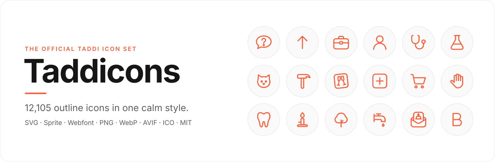

<p align="center">
  <a href="https://taddicons.com">
    <picture>
      <source media="(prefers-color-scheme: dark)" srcset="assets/taddicons-logo-light.png">
      
    </picture>
  </a>
</p>

<p align="center">
  <a href="https://taddicons.com">
    <picture>
      <source media="(prefers-color-scheme: dark)" srcset="assets/banner-dark.svg">
      
    </picture>
  </a>
</p>

<p align="center">
  <b><!-- count -->15,887<!-- /count --> outline icons in one calm style.</b><br>
  Every interface symbol, an icon for every kind of document people write, and the specialist icons other sets leave out,<br>
  from lab glassware and dental tools to plumbing valves and sailing knots. Free under the MIT License.
</p>

<p align="center">
  <a href="https://taddicons.com"></a>
  <a href="#formats"></a>
  <a href="CHANGELOG.md"></a>
  <a href="LICENSE"></a>
</p>

<p align="center">
  <a href="https://taddicons.com"><b>Website</b></a> ·
  <a href="#gallery">Gallery</a> ·
  <a href="#quick-start">Quick start</a> ·
  <a href="#formats">Formats</a> ·
  <a href="#webfont">Webfont</a> ·
  <a href="#style-guide">Style guide</a> ·
  <a href="#metadata">Metadata</a> ·
  <a href="LICENSE">License</a>
</p>

---

## Why Taddicons

Taddicons started as one icon for every kind of document [Taddi](https://taddi.app) writes (a "Tad"). Version 2 grows
it into a complete icon set: the interface icons every app needs, and thousands of specialist icons for the work and
life people actually write about.

- **<!-- count -->15,887<!-- /count --> icons in <!-- categories-count -->177<!-- /categories-count --> categories, in eight sections.** Documents and messages; interface (arrows, controls,
  text, files, communication, devices, media, design, code, charts, security, time, shapes, maths); business (office,
  commerce, finance, logistics, property); people (people, hands, accessibility, emoji, celebrations, faith, society);
  everyday life (health, dental, veterinary, beauty, baby, household, kitchen, food, clothing, education); science and
  leisure (science, the lab, sports, games, instruments, photography); the world (animals, nature, the outdoors,
  gardening, farming, weather, energy, transport, aviation, maritime, maps, buildings); and making things (tools, the
  trades, electronics, industry, crafts).
- **One style throughout.** A 24 px grid, a thin 1.35 line (never a hairline), round caps and joins, soft corners and
  warm, simple shapes. Calm and friendly, never cartoonish or technical.
- **Families you can read.** Cards are a card set down at a slight angle, invitations a card rising from an envelope,
  social posts a rounded square, and formal documents a page with a folded corner. The picture inside tells you the topic.
- **Every format you need.** SVG files in three colourings, an SVG sprite, a webfont with CSS classes and ligatures, and
  PNG, WebP, AVIF and ICO files in five sizes (in the [release downloads](https://github.com/taddicons/icons/releases/tag/v0.3.1)).
- **Made to be found.** Every icon has a section, a category and search keywords in [`icons.json`](icons.json); the
  document icons also have a frequency tier, a document kind and the channels they are sent on.
- **Free.** MIT licensed, for personal and commercial work.

## Quick start

### SVG files

Copy the icon you need from [`svg/outline`](svg/outline). The outline icons use `currentColor`, so they take the
colour of the text around them when you place them inline.

```html
<!-- As an image -->


<!-- Inline: the icon takes the text colour -->
<button class="btn">
  <svg width="20" height="20" viewBox="0 0 24 24" fill="none" stroke="currentColor" stroke-width="1.35"
       stroke-linecap="round" stroke-linejoin="round" aria-hidden="true">…paths from the file…</svg>
  New birthday card
</button>
```

### SVG sprite

One request for all <!-- count -->15,887<!-- /count --> icons. Each icon is a `<symbol>` with the icon's name as its id; the line style comes from the
`<svg>` that uses it, so you can change colour and weight with CSS.

```html
<svg width="24" height="24" fill="none" stroke="currentColor" stroke-width="1.35"
     stroke-linecap="round" stroke-linejoin="round" aria-hidden="true">
  <use href="/sprite/taddicons.svg#refund-request"/>
</svg>
```

### Webfont

```html
<link rel="stylesheet" href="https://cdn.jsdelivr.net/gh/taddicons/icons@0.3.1/font/taddicons.min.css">

<i class="ti ti-wedding-invitation"></i>
<i class="ti ti-2x ti-gradient ti-thank-you-note"></i>
<i class="ti ti-mark ti-cover-letter"></i>
```

### Images and favicons

The SVGs work as images anywhere, in two ready-made colourings besides the outline: `gradient` (the lines in the Taddi
gradient on a transparent background) and `mark` (the official mark: the gradient icon on a light circle):

```html

```

PNG, WebP and AVIF at 32 to 512 px and an ICO for every icon are in the [release downloads](https://github.com/taddicons/icons/releases/tag/v0.3.1), one ZIP per format,
sorted as `<format>/<colouring>/<size>/<name>.<ext>`.

Every file in this repository is on the jsDelivr CDN at
`https://cdn.jsdelivr.net/gh/taddicons/icons@0.3.1/<path>`, for example `.../svg/outline/lease-agreement.svg`.

## Formats

| Folder | Format | Colouring | Sizes | Best for |
|---|---|---|---|---|
| [`svg/outline`](svg/outline) | SVG | `currentColor` lines | scalable, 24 px grid | Websites and apps; any colour through CSS |
| [`svg/gradient`](svg/gradient) | SVG | Taddi gradient lines, transparent | scalable | Design tools, presentations |
| [`svg/mark`](svg/mark) | SVG | Gradient icon on the light circle | scalable, 40 px grid | Avatars, list markers, docs |
| [`sprite`](sprite) | SVG sprite | from the page | scalable | Many icons on one page with one request |
| [`font`](font) | WOFF2, WOFF, TTF, CSS, SCSS, JSON | text colour, or the gradient helpers | scalable | `<i class="ti ti-…">`, ligatures |
| [Release](https://github.com/taddicons/icons/releases/tag/v0.3.1) `png` | PNG | `gradient`, `mark` | 32, 64, 128, 256, 512 | Email, documents, anything without SVG |
| [Release](https://github.com/taddicons/icons/releases/tag/v0.3.1) `webp` | WebP (lossless) | `gradient`, `mark` | 32, 64, 128, 256, 512 | Small files for the web |
| [Release](https://github.com/taddicons/icons/releases/tag/v0.3.1) `avif` | AVIF | `gradient`, `mark` | 32, 64, 128, 256, 512 | The smallest files for modern browsers |
| [Release](https://github.com/taddicons/icons/releases/tag/v0.3.1) `ico` | ICO (PNG frames) | `mark` | 16, 24, 32, 48, 64, 128, 256 in one file | Favicons, Windows |
| [`icons.json`](icons.json) | JSON | | | Names, titles, sections, categories, keywords, code points |
| [`gallery`](gallery) | Markdown, HTML | | | One page per category, and the whole set on one searchable page |

With <!-- count -->15,887<!-- /count --> icons the raster files (about a gigabyte) no longer live in the repository: each format is one ZIP in the
[release downloads](https://github.com/taddicons/icons/releases/tag/v0.3.1), sorted as `<format>/<colouring>/<size>/<name>.<ext>`:

```
taddicons/
├── svg/
│   ├── outline/        one .svg per icon, currentColor
│   ├── gradient/       one .svg per icon
│   └── mark/           one .svg per icon
├── sprite/taddicons.svg
├── font/               taddicons.woff2 · .woff · .ttf · .css · .min.css · .scss · .json · demo.html
├── gallery/          <category>.md pages and index.html, the whole set
├── icons.json          metadata
└── scripts/            the build

release downloads (one ZIP each):
├── png/
│   ├── gradient/       32/ 64/ 128/ 256/ 512/
│   └── mark/           32/ 64/ 128/ 256/ 512/
├── webp/               same layout as png/
├── avif/               same layout as png/
└── ico/                one .ico per icon
```

## Webfont

The font is in [`font`](font). Load `taddicons.css` (or `taddicons.min.css`) and the font files next to it.

```html
<i class="ti ti-apology-letter" aria-hidden="true"></i>
```

| Class | What it does |
|---|---|
| `ti` | Base class, always needed |
| `ti-<name>` | The icon, for example `ti-job-application` |
| `ti-xs` `ti-sm` `ti-lg` `ti-xl` | 0.75, 0.875, 1.25 and 1.5 times the text size |
| `ti-2x` … `ti-10x` | 2 to 10 times the text size |
| `ti-fw` | Fixed width, so icons line up in lists and menus |
| `ti-rotate-90` `ti-rotate-180` `ti-rotate-270` | Rotate |
| `ti-flip-h` `ti-flip-v` `ti-flip-both` | Mirror |
| `ti-gradient` | The lines in the Taddi button gradient |
| `ti-mark` | The official mark: the gradient icon on a light circle |
| `ti-ul` + `ti-li` | Icons as list bullets |

**Ligatures.** The font knows every icon's name, so the name written as text turns into the icon:

```html
<span class="ti">birthday-card</span>
```

**Code points.** Icons sit in the Private Use Area from `U+E001`, in catalog order. The full map is in
[`font/taddicons.json`](font/taddicons.json) and as a Sass map in [`font/taddicons.scss`](font/taddicons.scss):

```scss
@use "taddicons" as ti;
.receipt::before { font-family: ti.$font-family; content: map-get(ti.$icons, "refund-request"); }
```

The font's line is drawn at 1.5 on the 24 grid (the SVGs use 1.35), so it stays crisp at 14 to 16 px. Open
[`font/demo.html`](font/demo.html) to see every glyph. With forced colours (Windows high contrast) the gradient
helpers fall back to the system text colour.

## Using it in an app

**React, with the sprite**

```jsx
export function Taddicon({ name, size = 24, label }) {
  return (
    <svg width={size} height={size} fill="none" stroke="currentColor" strokeLinecap="round" strokeLinejoin="round"
         strokeWidth={Math.max(1.35, 24 / size)} role={label ? "img" : undefined}
         aria-label={label} aria-hidden={label ? undefined : true}>
      <use href={`/taddicons.svg#${name}`} />
    </svg>
  );
}
```

**Any bundler, with the SVG files**: import `svg/outline/<name>.svg` with your SVG loader (SVGR, vite-svg-loader, …).

**Install from GitHub**

```sh
npm install github:taddicons/icons
```

## Message emoji

Every icon also comes as a message emoji: a white sticker (the shape filled and edged in white) with the lines in the
Taddi gradient. It reads on light, coloured and dark chat bubbles alike. Taddi uses these in its messages.

| File | What it is |
|---|---|
| `svg/emoji/<name>.svg` | One emoji, viewBox `-3 -3 30 30`, no shadow (add your own, for example a 0.5 px drop shadow) |
| `sprite/taddicons-emoji.svg` | Every emoji as a `<symbol>`, sharing one gradient. Inline it in the page and use `<svg width="28" height="28"><use href="#face-smile"/></svg>` |
| `emoji.json` | The picker groups (faces, hands, people, celebrations, food, animals, nature, travel, activities, objects, Taddi), and per emoji its title, keywords and the standard emoji it stands for when there is one |
| Release `png` / `webp` `emoji/` | 32, 64, 96 and 144 px with a soft shadow, for notifications and emails |

A message stores an emoji as a short code, `:face-tears-of-joy:`. Where the sticker cannot be shown, use the `unicode`
field from `emoji.json` (😂), or the title.

Taddi swaps emoji typed on a keyboard for their Taddicons match, so a thread looks the same throughout. `fromUnicode`
in `emoji.json` maps each standard emoji (without U+FE0F) to the one Taddicons emoji that replaces it; `swap` describes
the lookup (skin tones and gendered people fall back to the neutral form). Emoji with no match stay as typed.

## Style guide

| | |
|---|---|
| Grid | 24 × 24, drawn inside 2 to 22 |
| Line | 1.35 on the grid, round caps, round joins, no fills |
| Smallest line | 1 px on screen: for an icon drawn `s` px wide use `stroke-width = max(1.35, 24 / s)` |
| Best sizes | 16, 20, 24, 32, 48 px |
| Gradient | `#f76845` → `#f25e3a`, left to right (`oklch(70.66% 0.1785 34.6)` → `oklch(66.88% 0.1894 34.86)`) |
| Mark | Circle `#fafafa` (`lab(98.27 0 0)`), faint edge `#e4e4e4` (`lab(90.5 0 0)`), icon at 60% of the circle |

**Accessibility.** An icon next to a text label is decoration: give it `aria-hidden="true"`. An icon on its own needs
a name: `role="img"` and `aria-label="…"` on the `<svg>`, or `alt` on the ``. Keep icon buttons at least 24 px
(44 px on touch screens) and keep the line colour at 3:1 contrast or more against its background.

## Categories

<!-- categories:start -->
### Documents & messages

One icon for every kind of document Taddi writes. 10,447 icons.

| | Category | Icons | What it covers |
|:-:|---|--:|---|
|  | [Everyday messages](gallery/messages.md) | 90 | Quick notes, replies and emails for the day-to-day. |
|  | [Cards and greetings](gallery/cards.md) | 90 | Designed digital cards for every occasion, sent as a link or printed. |
|  | [Invitations and events](gallery/invitations.md) | 90 | Designed invitations with their own RSVP page, plus every message around an event. |
|  | [Social posts](gallery/social.md) | 90 | Posts with a picture for the networks you connected, written for regular people, not influencers. |
|  | [Life events and speeches](gallery/life.md) | 90 | Announcements, letters and the words for the big moments. |
|  | [Family and home](gallery/family.md) | 92 | Notes, plans and instructions that keep a household running. |
|  | [Letters to companies](gallery/consumer.md) | 90 | Complaints, refunds, cancellations and your consumer rights, done properly. |
|  | [Money and bills](gallery/money.md) | 90 | Invoices, reminders, payment plans, claims and money between friends. |
|  | [Home and renting](gallery/housing.md) | 90 | Landlords, tenants, neighbours and moving. |
|  | [Work and jobs](gallery/work.md) | 90 | Applications, requests and messages at work. |
|  | [Small business and side hustle](gallery/business.md) | 90 | Everything a small shop, freelancer or club treasurer sends to customers. |
|  | [Buy and sell](gallery/selling.md) | 92 | Listings and messages for selling and buying things online. |
|  | [School and learning](gallery/school.md) | 90 | For students, parents and teachers. |
|  | [Health and care](gallery/health.md) | 90 | Doctors, records, insurance and caring for someone. |
|  | [Government and official](gallery/government.md) | 90 | Authorities, appeals, permits and your representatives. |
|  | [Agreements and legal](gallery/legal.md) | 90 | Simple agreements, consents and formal notices; complex matters go to a lawyer. |
|  | [Community and clubs](gallery/community.md) | 93 | Clubs, teams, neighbours, volunteers and causes. |
|  | [Travel](gallery/travel.md) | 90 | Bookings, hosts, plans and postcards. |
|  | [Social media](gallery/social-media.md) | 90 | Posts, replies, threads and captions for the networks, written for regular people, not influencers. |
|  | [Jobs and careers](gallery/jobs-careers.md) | 90 | Everything between looking for work and leaving it: outreach, follow-ups, negotiation, references and moves. |
|  | [Academia and research](gallery/academia.md) | 90 | Students, supervisors and researchers: requests, extensions, appeals, applications and thanks. |
|  | [Creators and makers](gallery/creators.md) | 90 | Pitches, collaboration asks, sponsor replies and fan messages for people who make things and share them. |
|  | [Events and tickets](gallery/events-tickets.md) | 90 | Organising, selling and attending events: tickets, venues, vendors, speakers and refunds. |
|  | [Faith and ceremonies](gallery/faith-ceremonies.md) | 90 | Messages for religious and cultural ceremonies of every tradition, written with respect and without assuming one. |
|  | [Sports and clubs](gallery/sports-clubs.md) | 90 | Teams, clubs and hobby groups: sign-ups, fixtures, fees, kit, coaches and club news. |
|  | [Weddings](gallery/weddings.md) | 90 | From the engagement to the thank-you: invitations around the day, vendors, speeches and guest messages. |
|  | [Pets](gallery/pets.md) | 90 | Vets, boarding, adoption, lost and found, and everything else for the animal at home. |
|  | [Neighbourhood and environment](gallery/neighbourhood.md) | 90 | Neighbours, streets, councils and the local environment: asking, reporting and organising. |
|  | [Cars and transport](gallery/cars-transport.md) | 90 | Buying, selling, repairing and insuring a vehicle, and getting around: garages, fines, trains, flights and rides. |
|  | [Accounts and tech](gallery/accounts-tech.md) | 90 | Getting back into accounts, fixing devices and asking a company what it holds about you. |
|  | [Disability and access](gallery/disability-access.md) | 90 | Asking for what you need to take part, in plain words, with dignity and no jargon. |
|  | [Small business](gallery/small-business.md) | 90 | Customers, suppliers and staff of a small business: quotes, invoices, policies and polite firmness. |
|  | [Elder care and carers](gallery/elder-care.md) | 90 | Looking after an older person: care homes, carers, appointments, finances and family talks. |
|  | [Press and public voice](gallery/press.md) | 90 | Talking to journalists, editors and the public: pitches, corrections, statements and letters to the editor. |
|  | [Hospitality and stays](gallery/hospitality.md) | 90 | Hosting and staying: guests, rentals, restaurants, hotels and holiday homes. |
|  | [Nonprofits and volunteering](gallery/nonprofits.md) | 90 | Charities, volunteers and community groups: asking for help, thanking and reporting. |
|  | [Arts and publishing](gallery/arts-publishing.md) | 90 | Writers, artists and musicians: submissions, queries, commissions, bios and thank-yous. |
|  | [Dating and relationships](gallery/dating-relationships.md) | 90 | Starting, deepening, repairing and ending relationships, with honesty and kindness. |
|  | [Grief and memorial](gallery/grief-memorial.md) | 90 | Words for loss and remembering: telling people, asking for help, and honouring someone. |
|  | [Trades and home repairs](gallery/trades-documents.md) | 90 | Hiring, briefing and paying builders, plumbers, electricians and other trades, and what to do when it goes wrong. |
|  | [Celebrations of every culture](gallery/celebrations-documents.md) | 90 | Festivals, rites of passage and milestones from many cultures, written so anyone can send them to anyone. |
|  | [Health appointments and care](gallery/health-appointments.md) | 90 | Letters and messages to doctors, dentists, hospitals and clinics: booking, results, records, bills, access needs, thanks and complaints. |
|  | [Mental health and support](gallery/mental-health-support.md) | 90 | Gentle words for asking for help, checking in on others, therapy and work logistics, boundaries and recovery, without diagnosing anyone. |
|  | [Parenting babies and kids](gallery/parenting-babies-kids.md) | 90 | Notes for sitters, nurseries, teachers, doctors and other parents about the small children in your care, plus house rules and handover logistics. |
|  | [Parenting and teenagers](gallery/parenting-teens.md) | 90 | Notes to and about teens: house rules, school, driving, jobs, hard talks, apologies, trust and consequences. |
|  | [School and parents](gallery/school-parents.md) | 90 | Notes between families and schools: bullying, support, meetings, trips, uniforms, appeals, moves and class parent messages. |
|  | [Student life](gallery/student-life.md) | 90 | Everyday letters and messages for students: exams, grades, housing, roommates, internships, money, thesis work and clubs. |
|  | [Buying and selling a home](gallery/home-buying-selling.md) | 90 | Offers, viewings, agents, surveys, mortgages, moving dates, closing day and the welcome to the next owner. |
|  | [Home repairs and utilities](gallery/home-repairs-utilities.md) | 90 | Utility accounts, outages, bills, contractors, warranty and planning matters for the home. |
|  | [Renting as a tenant](gallery/renting-tenants.md) | 90 | Letters and messages for renters: problems at home, rent and deposits, moving in and out, flatmates and the building. |
|  | [Insurance and claims](gallery/insurance-claims.md) | 90 | Claims, disputes, policy questions, renewals and cancelling, for car, home, travel, health and life cover. |
|  | [Pregnancy and birth](gallery/pregnancy-birth.md) | 90 | Announcements, midwife and hospital notes, birth plans, leave, showers, thank-yous, visitors, sensitive loss and fertility notes, and adoption and surrogacy logistics. |
|  | [Being a landlord or property manager](gallery/landlords-property.md) | 90 | Letters and messages for landlords and property managers, from applicants and rent to repairs, notices, renewals and goodbyes. |
|  | [Banking, debt and credit](gallery/banking-debt.md) | 90 | Letters and messages for your bank, for people you owe, for people who owe you, and for credit records. |
|  | [Immigration and visas](gallery/immigration-visas.md) | 90 | Letters and messages for visa and residency applications, supporting documents, delays, appeals and settling into a new country. |
|  | [Travel and trips](gallery/travel-trips.md) | 90 | Planning trips with others, writing to hosts and hotels, sorting out problems on the road, travelling with extra needs, and sharing the trip afterwards. |
|  | [Airlines, hotels and holiday complaints](gallery/holiday-complaints.md) | 90 | Letters and messages to put right flight, hotel, package holiday, rental car and cruise problems, and to thank staff who helped. |
|  | [Consumer rights and refunds](gallery/consumer-refunds.md) | 90 | Letters and messages for getting your money or a fix when goods, deliveries, adverts or subscriptions go wrong, plus answers for small sellers. |
|  | [Online shopping and marketplaces](gallery/online-marketplaces.md) | 90 | Messages for buying and selling on marketplaces: questions, offers, pickups, problems, feedback and scam reports. |
|  | [Phone, internet and subscriptions](gallery/telecoms-subscriptions.md) | 90 | Plans, roaming, bills, outages, number porting, streaming and gym memberships, free trials, price rises, data privacy and moving home services. |
|  | [Taxes and benefits](gallery/taxes-benefits.md) | 90 | Letters and messages for tax offices, accountants, self-employed records, benefits, pensions and child support. |
|  | [Small claims and everyday legal](gallery/small-claims-legal.md) | 90 | Plain letters and notes for everyday disputes: getting ready for small claims, settling, mediation, contracts and talking to a lawyer, with no legal advice. |
|  | [Workplace for employees](gallery/workplace-employees.md) | 90 | Time off, pay problems, concerns and complaints, redundancy, and everyday notes to your boss and your colleagues. |
|  | [Managers and leaders](gallery/managers-leadership.md) | 90 | Feedback, warnings, hiring decisions, team news, one-to-ones and speeches for people who lead a team. |
|  | [Hiring and recruiting](gallery/hiring-recruiting.md) | 90 | Notes for both sides of a hire: job ads, outreach, interviews, offers, references, starting a job and moving inside a company. |
|  | [Freelancers and clients](gallery/freelancers-clients.md) | 90 | Everything a freelancer writes to clients, from first enquiry and kickoff to scope, money, boundaries, handover and referrals. |
|  | [Remote work and team coordination](gallery/remote-teams.md) | 90 | Clear updates, handoffs, meeting notes and team habits for people who work apart from each other. |
|  | [Customer support replies](gallery/customer-support-replies.md) | 90 | Clear, kind replies to customers: apologies, delays, refunds, outages, tough moments, help and goodbyes. |
|  | [Hobbies and clubs](gallery/hobbies-clubs.md) | 90 | Notes, posts and papers for book clubs, choirs, running groups, meetups, swaps, workshops and competitions. |
|  | [Volunteering and community](gallery/volunteering-community.md) | 90 | Recruiting and thanking volunteers, shift notes, food banks, mutual aid, charity runs, faith group logistics, clean-ups, neighbour help and committee papers. |
|  | [Sales and marketing outreach](gallery/sales-outreach.md) | 90 | Cold and warm outreach, follow-ups, demos, proposals, price talks, renewals, partner pitches, events and customer proof. |
|  | [Civic and local government](gallery/civic-local-government.md) | 90 | Letters, speeches and requests to councillors, councils, libraries, school boards and election helpers, so ordinary people can be heard where they live. |
|  | [Gaming and online communities](gallery/gaming-online-communities.md) | 90 | Guild and clan notes, moderator messages, ban appeals, tournaments, streamer and fan posts, game refunds and parent questions about games. |
|  | [Rural, farming and outdoors](gallery/rural-farming-outdoors.md) | 90 | Notes for land, farm sales, animals, seasonal workers, permits, camping, trails, bad weather and country neighbours. |
|  | [Apologies and difficult conversations](gallery/difficult-conversations.md) | 90 | Saying sorry, setting limits, giving bad news and mending things with the people who matter. |
|  | [Emergencies and disasters](gallery/emergencies-disasters.md) | 90 | Words for the worst days: checking on people, leaving home, claims, missing persons, asking for help, thanking those who came and rebuilding afterwards. |
|  | [Friendship and social life](gallery/friendship-social-life.md) | 90 | Making and changing plans, saying sorry, staying close from far away, hosting, and looking after friendships. |
|  | [Wedding guests and bridal party](gallery/wedding-guests.md) | 90 | Notes from the guest side of a wedding: replies, travel and stay questions, gifts, party planning, toasts and thank-yous. |
|  | [Estates, wills and executors](gallery/estates-probate.md) | 90 | Notes and letters for the practical, legal and family tasks that follow a death, from telling providers to clearing a house. |
|  | [Separation and divorce admin](gallery/divorce-separation.md) | 90 | The practical words for a separation: telling people, sharing money and homes, child schedules, professionals, records and calm messages to an ex. |
|  | [Military and veterans](gallery/military-veterans.md) | 90 | Letters and notes for deployed service members, their families and veterans, plus benefits, records, housing and remembrance. |
|  | [Living abroad and expats](gallery/expats-abroad.md) | 90 | Papers, banks, schools, doctors, homes and people when you have moved to another country. |
|  | [Languages and cultural exchange](gallery/language-exchange.md) | 90 | Notes for language partners, tutors, penpals, host families, study abroad, translators, cultural events and learning groups. |
|  | [Research and science collaboration](gallery/research-science.md) | 90 | Notes between researchers: sharing data and code, answering reviewers, grants, abstracts, ethics questions, credit and field work. |
|  | [Teachers and educators](gallery/teachers-educators.md) | 90 | Notes to parents, newsletters, praise and concern notes, report comments, trip letters and the everyday writing of a classroom. |
|  | [Healthcare professionals](gallery/healthcare-professionals.md) | 90 | Notes from clinicians and care staff: reminders, referrals, handovers, results, rotas, student placements, thanks and replies to complaints. |
|  | [Shops and market stalls](gallery/retail-markets.md) | 90 | Notes for shop owners and stallholders: sales, loyalty, apologies, suppliers, returns, fair applications and shop-local campaigns. |
|  | [Real estate agents and brokers](gallery/real-estate-agents.md) | 90 | Messages an agent sends to owners, buyers and tenants, from first contact and viewings to offers, hard news and closing day. |
|  | [Restaurants, cafes and food business](gallery/food-business.md) | 90 | Orders, quotes, bookings, allergy information, staff messages, reviews and market stalls for people who feed others for a living. |
|  | [Event planning professionals](gallery/event-pros.md) | 90 | Messages an event planner sends to clients, venues and vendors, from the first proposal to the post-event report. |
|  | [Coaches and sports organisers](gallery/coaches-sports.md) | 90 | Team lists, parent letters, travel and tournament plans, injuries, money, praise and hard talks for people who run a team or club. |
|  | [Musicians and performers](gallery/musicians-performers.md) | 90 | Gigs, riders, band life, lessons, recitals, releases and the money side of making music. |
|  | [Open source and developers](gallery/open-source-dev.md) | 90 | Kind, clear notes for issues, pull requests, releases, security reports, community rules, funding and handovers in shared software projects. |
|  | [Gifts and giving](gallery/gifts-giving.md) | 90 | Notes to go with gifts, thank-yous, kind ways to say no or return a gift, group collections, work gifts and gifts to charity. |
|  | [Tech help for family and seniors](gallery/tech-help-seniors.md) | 90 | Notes for asking for tech help, warning relatives about scams, explaining steps simply, reassuring nervous beginners and thanking the people who help. |
|  | [Photographers, filmmakers and clients](gallery/photo-film-clients.md) | 90 | Briefs, quotes, shoot plans, permissions, delivery, revisions and festival entries for people who make photos and films and the people who hire them. |
|  | [Official letters, Austria](gallery/official-at.md) | 90 | The official letters people in Austria most often need: tenancy, work, tax and banks, insurance, consumer rights, authorities, family and neighbours, written in correct Austrian German. |
|  | [Official letters, Australia](gallery/official-au.md) | 90 | The official letters people in Australia most often need: tenancy, work, tax and banks, insurance and benefits, consumer rights, authorities, school and neighbours, written in Australian English under state and federal law. |
|  | [Official letters, Belgium](gallery/official-be.md) | 90 | The official letters people in Belgium most often need: tenancy, work, tax and banks, insurance, consumer rights, authorities, family and neighbours, written in French as used in Wallonia and Brussels. |
|  | [Official letters, Brazil](gallery/official-br.md) | 90 | The official letters people in Brazil most often need: tenancy, work, money and tax, health plans and INSS, consumer rights, authorities, school and neighbours, written in correct Brazilian Portuguese. |
|  | [Official letters, Canada](gallery/official-ca.md) | 90 | The official letters people in Canada most often need: tenancy, work, tax and banks, benefits and privacy, consumer rights, insurance, school and neighbours, written in Canadian English and noting where provinces differ. |
|  | [Official letters, Switzerland](gallery/official-ch.md) | 90 | The official letters people in Switzerland most often need: tenancy, work, debt collection and tax, insurance, consumer rights, authorities, family and neighbours, written in correct Swiss standard German. |
|  | [Official letters, Germany](gallery/official-de.md) | 90 | The official letters people in Germany most often need: tenancy, work, tax and banks, insurance, consumer rights, authorities, family and neighbours, written in correct German. |
|  | [Official letters, Spain](gallery/official-es.md) | 90 | The official letters people in Spain most often need: tenancy, work, tax and banks, insurance, consumer rights, authorities, family and neighbours, written in correct Castilian Spanish. |
|  | [Official letters, France](gallery/official-fr.md) | 90 | The official letters people in France most often need: tenancy, work, tax and banks, insurance, consumer rights, authorities and data rights, family and neighbours, written in correct French. |
|  | [Official letters, Ireland](gallery/official-ie.md) | 90 | The official letters people in Ireland most often need: tenancy and the RTB, work and the WRC, tax and banks, insurance and health, consumer rights, FOI and data requests, school, family and neighbours, written in Irish English. |
|  | [Official letters, India](gallery/official-in.md) | 90 | The official letters people in India most often need: tenancy, work and provident fund, tax and banks, insurance, consumer complaints, RTI and government records, school and family, and neighbours, in correct Indian English. |
|  | [Official letters, Italy](gallery/official-it.md) | 90 | The official letters people in Italy most often need: tenancy, work, tax and banks, insurance and health, consumer rights, public offices, school and family, and neighbours, written in correct Italian. |
|  | [Official letters, Mexico](gallery/official-mx.md) | 90 | The official letters people in Mexico most often need: tenancy, work, tax and banks, insurance and social security, consumer rights, authorities, family and neighbours, written in correct Mexican Spanish. |
|  | [Official letters, Netherlands](gallery/official-nl.md) | 90 | The official letters people in the Netherlands most often need: tenancy, work, tax and banks, insurance, consumer rights, authorities, school and neighbours, written in correct Dutch. |
|  | [Official letters, New Zealand](gallery/official-nz.md) | 90 | The official letters people in New Zealand most often need: tenancy, work, tax and banks, insurance and ACC, consumer rights, authorities, family and neighbours, written in New Zealand English. |
|  | [Official letters, Poland](gallery/official-pl.md) | 90 | The official letters people in Poland most often need: tenancy, work, tax and banks, insurance and ZUS, consumer rights, authorities and data rights, school and family, neighbours, written in correct Polish. |
|  | [Official letters, Portugal](gallery/official-pt.md) | 90 | The official letters people in Portugal most often need: tenancy, work, tax and banks, insurance, consumer rights, authorities, school and neighbours, written in correct European Portuguese. |
|  | [Official letters, Sweden](gallery/official-se.md) | 90 | The official letters people in Sweden most often need: tenancy, work, tax and debts, insurance and health, consumer rights, authorities, school and neighbours, written in correct Swedish. |
|  | [Official letters, United Kingdom](gallery/official-uk.md) | 90 | The official letters people in the United Kingdom most often need: tenancy, work, money and tax, insurance and health, consumer rights, authorities and benefits, school and neighbours, written in British English. |
|  | [Official letters, United States](gallery/official-us.md) | 90 | The official letters people in the United States most often need: tenancy, work, credit and debt, insurance and health, consumer rights, tax and government, school and neighbours, written in American English with state variation noted. |

### Interface

Arrows, controls, files, media, code and the symbols of every app. 1,957 icons.

| | Category | Icons | What it covers |
|:-:|---|--:|---|
|  | [Arrows & directions](gallery/arrows.md) | 189 | Arrows, chevrons, turns, swaps and every way to point. |
|  | [Interface & controls](gallery/interface.md) | 292 | Menus, views, toggles, states, alerts and window chrome. |
|  | [Text & editing](gallery/text.md) | 104 | Formatting, alignment, lists, headings and writing tools. |
|  | [Letters, numbers & punctuation](gallery/alphabet.md) | 110 | A to Z, 0 to 9 and the marks between them. |
|  | [Files & folders](gallery/files.md) | 186 | Files, folders, archives and storage. |
|  | [Communication](gallery/communication.md) | 108 | Chat, mail, calls, contacts and announcements. |
|  | [Devices & hardware](gallery/devices.md) | 105 | Computers, phones, peripherals, parts and power. |
|  | [Network & cloud](gallery/connectivity.md) | 82 | Wi-Fi, signal, cloud, servers, databases and links. |
|  | [Media & playback](gallery/media.md) | 191 | Playback, audio, music, photo, video and film. |
|  | [Design & creative](gallery/design.md) | 106 | Drawing tools, layers, alignment, colour and shapes tools. |
|  | [Code & development](gallery/code.md) | 104 | Code, terminals, version control, builds and bots. |
|  | [Charts & data](gallery/charts.md) | 99 | Charts, dashboards, diagrams and analytics. |
|  | [Security & privacy](gallery/security.md) | 94 | Shields, locks, keys, identity and protection. |
|  | [Time & calendar](gallery/time.md) | 79 | Clocks, timers, calendars and schedules. |
|  | [Shapes & symbols](gallery/shapes.md) | 54 | Geometric shapes, solids, badges and common symbols. |
|  | [Math](gallery/math.md) | 54 | Operators, functions, geometry and set notation. |

### Business & money

Offices, shops, payments, shipping and property. 405 icons.

| | Category | Icons | What it covers |
|:-:|---|--:|---|
|  | [Office & business](gallery/office.md) | 101 | Work, meetings, desks, goals, hiring and support. |
|  | [Shopping & commerce](gallery/commerce.md) | 107 | Carts, bags, stores, tags, coupons and orders. |
|  | [Money & finance](gallery/finance.md) | 106 | Coins, cards, banks, currencies, savings and taxes. |
|  | [Logistics & moving](gallery/logistics.md) | 66 | Boxes, pallets, warehouses, delivery and moving. |
|  | [Property & legal](gallery/property.md) | 25 | Homes for sale or rent, plans, contracts and courts. |

### People & society

People, hands, feelings, access, faith and celebrations. 485 icons.

| | Category | Icons | What it covers |
|:-:|---|--:|---|
|  | [People & users](gallery/people.md) | 112 | Users, groups, roles, figures and actions. |
|  | [Hands & gestures](gallery/hands.md) | 61 | Hands, signs and gestures. |
|  | [Accessibility](gallery/accessibility.md) | 47 | Access, mobility, vision, hearing and assistance. |
|  | [Emoji & feelings](gallery/emoji.md) | 89 | Faces, moods and reactions. |
|  | [Holidays & celebrations](gallery/celebrations.md) | 67 | Parties, gifts, seasons and festivities. |
|  | [Faith & spirituality](gallery/faith.md) | 34 | Symbols and places of faith, drawn with respect. |
|  | [Society & causes](gallery/society.md) | 75 | Charity, civic life, voting, rights and relief. |

### Everyday life & health

Health, home, kitchen, food, clothing, care and school. 868 icons.

| | Category | Icons | What it covers |
|:-:|---|--:|---|
|  | [Medical & health](gallery/medical.md) | 176 | Care, medicine, the body, tests and specialties. |
|  | [Dental care](gallery/dental.md) | 34 | Teeth, treatments and the dentist's tools. |
|  | [Veterinary care](gallery/veterinary.md) | 23 | Care for pets and farm animals. |
|  | [Beauty & wellness](gallery/beauty.md) | 31 | Salon, skin care, make-up and spa. |
|  | [Baby & kids care](gallery/baby.md) | 25 | Bottles, cribs, prams and everything for little ones. |
|  | [Home & household](gallery/household.md) | 110 | Furniture, rooms, appliances and cleaning. |
|  | [Kitchen & cooking](gallery/kitchen.md) | 80 | Appliances, pans, utensils and baking. |
|  | [Food & drink](gallery/food.md) | 200 | Meals, drinks, fruit, vegetables and ingredients. |
|  | [Clothing & fashion](gallery/clothing.md) | 90 | Clothes, shoes, accessories and care labels. |
|  | [Education & learning](gallery/education.md) | 99 | School, books, classes and graduation. |

### Science, sport & play

Labs, space, sport, games, music and the studio. 497 icons.

| | Category | Icons | What it covers |
|:-:|---|--:|---|
|  | [Science & space](gallery/science.md) | 107 | Physics, chemistry, biology, earth and the stars. |
|  | [Laboratory equipment](gallery/lab.md) | 63 | Glassware, instruments and lab safety. |
|  | [Sports & fitness](gallery/sports.md) | 166 | Balls, gear, gyms and athletes. |
|  | [Games & toys](gallery/games.md) | 99 | Consoles, cards, chess, toys and fantasy. |
|  | [Musical instruments](gallery/instruments.md) | 38 | Strings, keys, drums, brass, wind and notation. |
|  | [Photo & studio gear](gallery/photo-gear.md) | 24 | Cameras, lenses, lights and studio kit. |

### World & nature

Animals, plants, weather, energy, travel and places. 934 icons.

| | Category | Icons | What it covers |
|:-:|---|--:|---|
|  | [Animals](gallery/animals.md) | 110 | Pets, farm animals, wildlife, birds, fish and insects. |
|  | [Nature](gallery/nature.md) | 62 | Trees, flowers, plants, landscapes and water. |
|  | [Camping & outdoors](gallery/outdoors.md) | 38 | Tents, campfires, trails and gear. |
|  | [Gardening](gallery/garden.md) | 31 | Garden tools, pots, beds and lawns. |
|  | [Farming & agriculture](gallery/farming.md) | 53 | Fields, machines, livestock and harvest. |
|  | [Weather & seasons](gallery/weather.md) | 98 | Sun, clouds, rain, wind, temperature and seasons. |
|  | [Energy & environment](gallery/energy.md) | 90 | Power, renewables, fuel, emissions and plants. |
|  | [Transport & vehicles](gallery/transport.md) | 194 | Cars, bikes, buses, trains, planes and boats. |
|  | [Aviation & airports](gallery/aviation.md) | 29 | Flight decks, airports and air travel. |
|  | [Maritime & rail](gallery/maritime.md) | 26 | Ships, harbours, navigation and the railway. |
|  | [Maps & travel](gallery/maps.md) | 102 | Maps, pins, navigation, luggage and hotels. |
|  | [Buildings & places](gallery/buildings.md) | 101 | Homes, towers, public buildings and city parts. |

### Tools & trades

Tools, building, the trades, electronics, industry and crafts. 294 icons.

| | Category | Icons | What it covers |
|:-:|---|--:|---|
|  | [Tools & construction](gallery/tools.md) | 110 | Hand tools, power tools, safety and building sites. |
|  | [Plumbing, electrical & HVAC](gallery/trades.md) | 62 | Pipes, valves, wiring, breakers and climate. |
|  | [Electronic components](gallery/electronics.md) | 62 | Parts, circuits, sensors, motors and logic. |
|  | [Manufacturing & safety](gallery/industry.md) | 29 | Machines, production and workplace safety. |
|  | [Sewing & crafts](gallery/crafts.md) | 31 | Sewing, knitting, paper, clay and handiwork. |

**All: 15,887 icons in 177 categories.**
<!-- categories:end -->

## Gallery

<!-- gallery:start -->
Every icon with its name, one page per category. The same set is on [taddicons.com](https://taddicons.com) with search,
and on one page in [`gallery/index.html`](gallery/index.html).

- **Documents & messages:** [Everyday messages](gallery/messages.md) · [Cards and greetings](gallery/cards.md) · [Invitations and events](gallery/invitations.md) · [Social posts](gallery/social.md) · [Life events and speeches](gallery/life.md) · [Family and home](gallery/family.md) · [Letters to companies](gallery/consumer.md) · [Money and bills](gallery/money.md) · [Home and renting](gallery/housing.md) · [Work and jobs](gallery/work.md) · [Small business and side hustle](gallery/business.md) · [Buy and sell](gallery/selling.md) · [School and learning](gallery/school.md) · [Health and care](gallery/health.md) · [Government and official](gallery/government.md) · [Agreements and legal](gallery/legal.md) · [Community and clubs](gallery/community.md) · [Travel](gallery/travel.md) · [Social media](gallery/social-media.md) · [Jobs and careers](gallery/jobs-careers.md) · [Academia and research](gallery/academia.md) · [Creators and makers](gallery/creators.md) · [Events and tickets](gallery/events-tickets.md) · [Faith and ceremonies](gallery/faith-ceremonies.md) · [Sports and clubs](gallery/sports-clubs.md) · [Weddings](gallery/weddings.md) · [Pets](gallery/pets.md) · [Neighbourhood and environment](gallery/neighbourhood.md) · [Cars and transport](gallery/cars-transport.md) · [Accounts and tech](gallery/accounts-tech.md) · [Disability and access](gallery/disability-access.md) · [Small business](gallery/small-business.md) · [Elder care and carers](gallery/elder-care.md) · [Press and public voice](gallery/press.md) · [Hospitality and stays](gallery/hospitality.md) · [Nonprofits and volunteering](gallery/nonprofits.md) · [Arts and publishing](gallery/arts-publishing.md) · [Dating and relationships](gallery/dating-relationships.md) · [Grief and memorial](gallery/grief-memorial.md) · [Trades and home repairs](gallery/trades-documents.md) · [Celebrations of every culture](gallery/celebrations-documents.md) · [Health appointments and care](gallery/health-appointments.md) · [Mental health and support](gallery/mental-health-support.md) · [Parenting babies and kids](gallery/parenting-babies-kids.md) · [Parenting and teenagers](gallery/parenting-teens.md) · [School and parents](gallery/school-parents.md) · [Student life](gallery/student-life.md) · [Buying and selling a home](gallery/home-buying-selling.md) · [Home repairs and utilities](gallery/home-repairs-utilities.md) · [Renting as a tenant](gallery/renting-tenants.md) · [Insurance and claims](gallery/insurance-claims.md) · [Pregnancy and birth](gallery/pregnancy-birth.md) · [Being a landlord or property manager](gallery/landlords-property.md) · [Banking, debt and credit](gallery/banking-debt.md) · [Immigration and visas](gallery/immigration-visas.md) · [Travel and trips](gallery/travel-trips.md) · [Airlines, hotels and holiday complaints](gallery/holiday-complaints.md) · [Consumer rights and refunds](gallery/consumer-refunds.md) · [Online shopping and marketplaces](gallery/online-marketplaces.md) · [Phone, internet and subscriptions](gallery/telecoms-subscriptions.md) · [Taxes and benefits](gallery/taxes-benefits.md) · [Small claims and everyday legal](gallery/small-claims-legal.md) · [Workplace for employees](gallery/workplace-employees.md) · [Managers and leaders](gallery/managers-leadership.md) · [Hiring and recruiting](gallery/hiring-recruiting.md) · [Freelancers and clients](gallery/freelancers-clients.md) · [Remote work and team coordination](gallery/remote-teams.md) · [Customer support replies](gallery/customer-support-replies.md) · [Hobbies and clubs](gallery/hobbies-clubs.md) · [Volunteering and community](gallery/volunteering-community.md) · [Sales and marketing outreach](gallery/sales-outreach.md) · [Civic and local government](gallery/civic-local-government.md) · [Gaming and online communities](gallery/gaming-online-communities.md) · [Rural, farming and outdoors](gallery/rural-farming-outdoors.md) · [Apologies and difficult conversations](gallery/difficult-conversations.md) · [Emergencies and disasters](gallery/emergencies-disasters.md) · [Friendship and social life](gallery/friendship-social-life.md) · [Wedding guests and bridal party](gallery/wedding-guests.md) · [Estates, wills and executors](gallery/estates-probate.md) · [Separation and divorce admin](gallery/divorce-separation.md) · [Military and veterans](gallery/military-veterans.md) · [Living abroad and expats](gallery/expats-abroad.md) · [Languages and cultural exchange](gallery/language-exchange.md) · [Research and science collaboration](gallery/research-science.md) · [Teachers and educators](gallery/teachers-educators.md) · [Healthcare professionals](gallery/healthcare-professionals.md) · [Shops and market stalls](gallery/retail-markets.md) · [Real estate agents and brokers](gallery/real-estate-agents.md) · [Restaurants, cafes and food business](gallery/food-business.md) · [Event planning professionals](gallery/event-pros.md) · [Coaches and sports organisers](gallery/coaches-sports.md) · [Musicians and performers](gallery/musicians-performers.md) · [Open source and developers](gallery/open-source-dev.md) · [Gifts and giving](gallery/gifts-giving.md) · [Tech help for family and seniors](gallery/tech-help-seniors.md) · [Photographers, filmmakers and clients](gallery/photo-film-clients.md) · [Official letters, Austria](gallery/official-at.md) · [Official letters, Australia](gallery/official-au.md) · [Official letters, Belgium](gallery/official-be.md) · [Official letters, Brazil](gallery/official-br.md) · [Official letters, Canada](gallery/official-ca.md) · [Official letters, Switzerland](gallery/official-ch.md) · [Official letters, Germany](gallery/official-de.md) · [Official letters, Spain](gallery/official-es.md) · [Official letters, France](gallery/official-fr.md) · [Official letters, Ireland](gallery/official-ie.md) · [Official letters, India](gallery/official-in.md) · [Official letters, Italy](gallery/official-it.md) · [Official letters, Mexico](gallery/official-mx.md) · [Official letters, Netherlands](gallery/official-nl.md) · [Official letters, New Zealand](gallery/official-nz.md) · [Official letters, Poland](gallery/official-pl.md) · [Official letters, Portugal](gallery/official-pt.md) · [Official letters, Sweden](gallery/official-se.md) · [Official letters, United Kingdom](gallery/official-uk.md) · [Official letters, United States](gallery/official-us.md)
- **Interface:** [Arrows & directions](gallery/arrows.md) · [Interface & controls](gallery/interface.md) · [Text & editing](gallery/text.md) · [Letters, numbers & punctuation](gallery/alphabet.md) · [Files & folders](gallery/files.md) · [Communication](gallery/communication.md) · [Devices & hardware](gallery/devices.md) · [Network & cloud](gallery/connectivity.md) · [Media & playback](gallery/media.md) · [Design & creative](gallery/design.md) · [Code & development](gallery/code.md) · [Charts & data](gallery/charts.md) · [Security & privacy](gallery/security.md) · [Time & calendar](gallery/time.md) · [Shapes & symbols](gallery/shapes.md) · [Math](gallery/math.md)
- **Business & money:** [Office & business](gallery/office.md) · [Shopping & commerce](gallery/commerce.md) · [Money & finance](gallery/finance.md) · [Logistics & moving](gallery/logistics.md) · [Property & legal](gallery/property.md)
- **People & society:** [People & users](gallery/people.md) · [Hands & gestures](gallery/hands.md) · [Accessibility](gallery/accessibility.md) · [Emoji & feelings](gallery/emoji.md) · [Holidays & celebrations](gallery/celebrations.md) · [Faith & spirituality](gallery/faith.md) · [Society & causes](gallery/society.md)
- **Everyday life & health:** [Medical & health](gallery/medical.md) · [Dental care](gallery/dental.md) · [Veterinary care](gallery/veterinary.md) · [Beauty & wellness](gallery/beauty.md) · [Baby & kids care](gallery/baby.md) · [Home & household](gallery/household.md) · [Kitchen & cooking](gallery/kitchen.md) · [Food & drink](gallery/food.md) · [Clothing & fashion](gallery/clothing.md) · [Education & learning](gallery/education.md)
- **Science, sport & play:** [Science & space](gallery/science.md) · [Laboratory equipment](gallery/lab.md) · [Sports & fitness](gallery/sports.md) · [Games & toys](gallery/games.md) · [Musical instruments](gallery/instruments.md) · [Photo & studio gear](gallery/photo-gear.md)
- **World & nature:** [Animals](gallery/animals.md) · [Nature](gallery/nature.md) · [Camping & outdoors](gallery/outdoors.md) · [Gardening](gallery/garden.md) · [Farming & agriculture](gallery/farming.md) · [Weather & seasons](gallery/weather.md) · [Energy & environment](gallery/energy.md) · [Transport & vehicles](gallery/transport.md) · [Aviation & airports](gallery/aviation.md) · [Maritime & rail](gallery/maritime.md) · [Maps & travel](gallery/maps.md) · [Buildings & places](gallery/buildings.md)
- **Tools & trades:** [Tools & construction](gallery/tools.md) · [Plumbing, electrical & HVAC](gallery/trades.md) · [Electronic components](gallery/electronics.md) · [Manufacturing & safety](gallery/industry.md) · [Sewing & crafts](gallery/crafts.md)
<!-- gallery:end -->

## Metadata

[`icons.json`](icons.json) describes the set: `sections` (each with its `categories`), `categories` (each with its
`section`) and `icons`. Every icon has these fields:

```json
{
  "name": "test-tube",
  "title": "Test tube",
  "category": "lab",
  "categoryTitle": "Laboratory",
  "tags": ["sample", "experiment", "chemistry", "lab", "liquid"],
  "unicode": "e9a1"
}
```

| Field | Meaning |
|---|---|
| `name` | The icon's name: file name, sprite id, CSS class (`ti-<name>`) and ligature |
| `title` | A short English title |
| `category` | The category id (`categories` at the top of the file says which section it belongs to) |
| `tags` | Search keywords |
| `unicode` | The webfont code point (hex) |

The document icons (the first section, from Taddicons 1) also say what kind of document they are and how it travels:

| Field | Meaning |
|---|---|
| `tier` | How often people need this document: `essential`, `daily`, `special` or `rare` |
| `kind` | The kind of document: `letter`, `email`, `message`, `document`, `card`, `post`, `invitation`, `speech`, … |
| `channels` | How it is usually sent: `email`, `sms`, `whatsapp`, `pdf`, `print`, `post`, `link`, … |

## Names and versions

Icon names are lowercase kebab-case (`arrow-up-right`, `notice-to-vacate`); the document icons use the document type
keys Taddi uses. Names and code points never change within a major version, and new icons are added at the end. Version
2 keeps every name and code point of version 1 (`U+E001` to `U+E190`). Version history is in
[CHANGELOG.md](CHANGELOG.md).

## Build from source

The SVG files in `svg/outline` and the metadata in `icons.json` are the source; everything else is generated.

```sh
npm install                                  # sharp, for PNG, WebP, AVIF and ICO
python3 -m pip install -r scripts/requirements.txt   # fontTools, skia-pathops, picosvg, for the webfont
npm run build                                # font, images, then the README tables, gallery pages and banner
npm run release                              # the PNG, WebP, AVIF and ICO ZIPs for the GitHub release (release/)
```

| Script | Makes |
|---|---|
| [`scripts/build-font.py`](scripts/build-font.py) | Turns every line into a filled outline, merges it into one glyph, and writes WOFF2, WOFF, TTF, the CSS, the SCSS map and the code point JSON |
| [`scripts/build-images.mjs`](scripts/build-images.mjs) | The sprites, the gradient, mark and emoji SVGs, all PNG, WebP and AVIF sizes and the ICO files |
| [`scripts/build-emoji.mjs`](scripts/build-emoji.mjs) | `emoji.json`: the picker groups and each emoji's title, keywords and standard emoji (matches in `scripts/emoji-unicode.json`) |
| [`scripts/build-docs.mjs`](scripts/build-docs.mjs) | The README banner and category tables, the gallery pages and `gallery/index.html`, and `font/demo.html` |
| [`scripts/package-release.mjs`](scripts/package-release.mjs) | One ZIP per raster format for the GitHub release |

## Contributing

Found an icon that could read more clearly, or an icon that is missing? Open an
[issue](https://github.com/taddicons/icons/issues). New drawings follow the [style guide](#style-guide): the 24
grid, the 1.35 line, round caps and joins, outline only, at most about six shapes, and readable at 16 px.

## License

Taddicons is released under the [MIT License](LICENSE). Use the icons in personal and commercial projects, change
them and share them; keep the copyright notice with copies of the set. The Taddi name and logo are trademarks of Taddi
and are not covered by this license.

---

<p align="center">
  <a href="https://taddi.app">
    <picture>
      <source media="(prefers-color-scheme: dark)" srcset="assets/taddi-logo-light.png">
      
    </picture>
  </a>
</p>

<p align="center"><sub>Made by <a href="https://taddi.app">Taddi</a>, one app to communicate online.<br>
Copyright © 2026 Taddi. Taddicons is released under the <a href="LICENSE">MIT License</a>. Taddi is a product by <a href="https://avonao.com">Avonao</a>.</sub></p>
