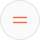
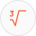
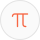
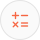

# Math

Taddicons 2.1.0 · Interface · 54 icons

Operators, functions, geometry and set notation.

<table>
<tr>
<td align="center" width="16%"> <b>Multiply</b> <code>multiply</code></td>
<td align="center" width="16%"> <b>Divide</b> <code>divide</code></td>
<td align="center" width="16%"> <b>Equals</b> <code>equals</code></td>
<td align="center" width="16%"> <b>Not equal</b> <code>not-equal</code></td>
<td align="center" width="16%"> <b>Approximately equal</b> <code>approximately</code></td>
<td align="center" width="16%"> <b>Greater than</b> <code>greater-than</code></td>
</tr>
<tr>
<td align="center" width="16%"> <b>Less than</b> <code>less-than</code></td>
<td align="center" width="16%"> <b>Greater than or equal</b> <code>greater-than-or-equal</code></td>
<td align="center" width="16%"> <b>Less than or equal</b> <code>less-than-or-equal</code></td>
<td align="center" width="16%"> <b>Square root</b> <code>square-root</code></td>
<td align="center" width="16%"> <b>Cube root</b> <code>cube-root</code></td>
<td align="center" width="16%"> <b>Pi</b> <code>pi</code></td>
</tr>
<tr>
<td align="center" width="16%"> <b>Sigma</b> <code>sigma</code></td>
<td align="center" width="16%"> <b>Integral</b> <code>integral</code></td>
<td align="center" width="16%"> <b>X squared</b> <code>x-squared</code></td>
<td align="center" width="16%"> <b>Fraction</b> <code>fraction</code></td>
<td align="center" width="16%"> <b>Decimal</b> <code>decimal</code></td>
<td align="center" width="16%"> <b>Ratio</b> <code>ratio</code></td>
</tr>
<tr>
<td align="center" width="16%"> <b>Angle</b> <code>angle</code></td>
<td align="center" width="16%"> <b>Obtuse angle</b> <code>angle-obtuse</code></td>
<td align="center" width="16%"> <b>Right angle</b> <code>right-angle</code></td>
<td align="center" width="16%"> <b>Parallel</b> <code>parallel</code></td>
<td align="center" width="16%"> <b>Perpendicular</b> <code>perpendicular</code></td>
<td align="center" width="16%"> <b>Coordinate plane</b> <code>coordinate-plane</code></td>
</tr>
<tr>
<td align="center" width="16%"> <b>Sine wave</b> <code>sine-wave</code></td>
<td align="center" width="16%"> <b>Parabola</b> <code>parabola</code></td>
<td align="center" width="16%"> <b>Matrix</b> <code>matrix</code></td>
<td align="center" width="16%"> <b>Logarithm</b> <code>logarithm</code></td>
<td align="center" width="16%"> <b>Exponential</b> <code>exponential</code></td>
<td align="center" width="16%"> <b>Factorial</b> <code>factorial</code></td>
</tr>
<tr>
<td align="center" width="16%"> <b>Union</b> <code>set-union</code></td>
<td align="center" width="16%"> <b>Intersection</b> <code>set-intersection</code></td>
<td align="center" width="16%"> <b>Subset</b> <code>subset</code></td>
<td align="center" width="16%"> <b>Superset</b> <code>superset</code></td>
<td align="center" width="16%"> <b>Element of</b> <code>element-of</code></td>
<td align="center" width="16%"> <b>Not element of</b> <code>not-element-of</code></td>
</tr>
<tr>
<td align="center" width="16%"> <b>For all</b> <code>for-all</code></td>
<td align="center" width="16%"> <b>There exists</b> <code>there-exists</code></td>
<td align="center" width="16%"> <b>Therefore</b> <code>therefore</code></td>
<td align="center" width="16%"> <b>Because</b> <code>because</code></td>
<td align="center" width="16%"> <b>Empty set</b> <code>empty-set</code></td>
<td align="center" width="16%"> <b>Number line</b> <code>number-line</code></td>
</tr>
<tr>
<td align="center" width="16%"> <b>Proportional to</b> <code>proportional</code></td>
<td align="center" width="16%"> <b>Equivalent</b> <code>equivalent</code></td>
<td align="center" width="16%"> <b>Circle radius</b> <code>circle-radius</code></td>
<td align="center" width="16%"> <b>Circle diameter</b> <code>circle-diameter</code></td>
<td align="center" width="16%"> <b>Circle sector</b> <code>circle-sector</code></td>
<td align="center" width="16%"> <b>Circle tangent</b> <code>circle-tangent</code></td>
</tr>
<tr>
<td align="center" width="16%"> <b>Math operations</b> <code>math-operations</code></td>
<td align="center" width="16%"> <b>Absolute value</b> <code>absolute-value</code></td>
<td align="center" width="16%"> <b>Partial derivative</b> <code>partial-derivative</code></td>
<td align="center" width="16%"> <b>Line intersection</b> <code>line-intersection</code></td>
<td align="center" width="16%"> <b>Mean</b> <code>mean</code></td>
<td align="center" width="16%"> <b>Logical not</b> <code>logic-not</code></td>
</tr>
</table>

[← Shapes & symbols](shapes.md) · [All categories](../README.md#gallery) · [Office & business →](office.md)
