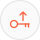
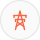

# Official letters, Netherlands

Taddicons 0.3.0 · Documents & messages · 70 icons

The official letters people in the Netherlands most often need: tenancy, work, tax and banks, insurance, consumer rights, authorities, school and neighbours, written in correct Dutch.

<table>
<tr>
<td align="center" width="16%"> <b>Huur opzeggen: end your rental contract (Netherlands)</b> <code>nl-huur-opzeggen</code></td>
<td align="center" width="16%"> <b>Gebrek melden: report a defect to your landlord (Netherlands)</b> <code>nl-gebrek-melden</code></td>
<td align="center" width="16%"> <b>Huurverlaging: ask for a rent reduction (Netherlands)</b> <code>nl-huurverlaging-verzoek</code></td>
<td align="center" width="16%"> <b>Borg terugvragen: demand your rental deposit back (Netherlands)</b> <code>nl-borg-terugvragen</code></td>
<td align="center" width="16%"> <b>Servicekosten afrekening: object to the service-cost statement (Netherlands)</b> <code>nl-servicekosten-bezwaar</code></td>
<td align="center" width="16%"> <b>Huurverhoging: object to a rent increase (Netherlands)</b> <code>nl-huurverhoging-bezwaar</code></td>
</tr>
<tr>
<td align="center" width="16%"> <b>Opzeggen arbeidsovereenkomst: resign from your job (Netherlands)</b> <code>nl-ontslag-nemen</code></td>
<td align="center" width="16%"> <b>Loonvordering: demand unpaid wages (Netherlands)</b> <code>nl-loon-ingebrekestelling</code></td>
<td align="center" width="16%"> <b>Ouderschapsverlof: request parental leave (Netherlands)</b> <code>nl-ouderschapsverlof</code></td>
<td align="center" width="16%"> <b>Wet flexibel werken: request to change hours or place (Netherlands)</b> <code>nl-flexwerken-verzoek</code></td>
<td align="center" width="16%"> <b>Bezwaar Belastingdienst: object to a tax assessment (Netherlands)</b> <code>nl-belasting-bezwaar</code></td>
<td align="center" width="16%"> <b>Uitstel van betaling: ask the Belastingdienst for payment delay (Netherlands)</b> <code>nl-belasting-uitstel</code></td>
</tr>
<tr>
<td align="center" width="16%"> <b>Betalingsregeling: propose a payment plan (Netherlands)</b> <code>nl-betalingsregeling</code></td>
<td align="center" width="16%"> <b>Vordering betwisten: dispute a debt claim or collection letter (Netherlands)</b> <code>nl-vordering-betwisten</code></td>
<td align="center" width="16%"> <b>Klacht bank: complain to your bank (Netherlands)</b> <code>nl-bank-klacht</code></td>
<td align="center" width="16%"> <b>Bezwaar WOZ-waarde: object to your property valuation (Netherlands)</b> <code>nl-woz-bezwaar</code></td>
<td align="center" width="16%"> <b>Zorgverzekering opzeggen: cancel your health insurance (Netherlands)</b> <code>nl-zorgverzekering-opzeg</code></td>
<td align="center" width="16%"> <b>Klacht verzekeraar: complain to your insurer (Netherlands)</b> <code>nl-verzekering-klacht</code></td>
</tr>
<tr>
<td align="center" width="16%"> <b>Schademelding: notify your insurer of a claim (Netherlands)</b> <code>nl-schademelding</code></td>
<td align="center" width="16%"> <b>Afwijzing van een claim: dispute a refused claim (Netherlands)</b> <code>nl-claim-afwijzing-bezwaar</code></td>
<td align="center" width="16%"> <b>Bezwaar UWV: object to a UWV decision (Netherlands)</b> <code>nl-uwv-bezwaar</code></td>
<td align="center" width="16%"> <b>Ingebrekestelling: formal notice of default (Netherlands)</b> <code>nl-ingebrekestelling</code></td>
<td align="center" width="16%"> <b>Abonnement opzeggen: cancel a subscription (Netherlands)</b> <code>nl-abonnement-opzeggen</code></td>
<td align="center" width="16%"> <b>Herroeping online aankoop: withdraw from an online purchase (Netherlands)</b> <code>nl-herroeping-aankoop</code></td>
</tr>
<tr>
<td align="center" width="16%"> <b>Gebrekkig product: complain about a faulty product (Netherlands)</b> <code>nl-product-gebrek</code></td>
<td align="center" width="16%"> <b>Klacht over reis: complain about a holiday or travel booking (Netherlands)</b> <code>nl-reis-klacht</code></td>
<td align="center" width="16%"> <b>Klacht energieleverancier: complain to your energy supplier (Netherlands)</b> <code>nl-energie-klacht</code></td>
<td align="center" width="16%"> <b>Bezwaarschrift: object to a government decision (Netherlands)</b> <code>nl-bezwaarschrift</code></td>
<td align="center" width="16%"> <b>AVG-inzageverzoek: ask what personal data an organisation holds (Netherlands)</b> <code>nl-avg-inzage</code></td>
<td align="center" width="16%"> <b>AVG-verwijderverzoek: ask for your data to be erased (Netherlands)</b> <code>nl-avg-verwijdering</code></td>
</tr>
<tr>
<td align="center" width="16%"> <b>Woo-verzoek: ask a public body for documents (Netherlands)</b> <code>nl-woo-verzoek</code></td>
<td align="center" width="16%"> <b>Bezwaar Toeslagen: object to a benefit decision (Netherlands)</b> <code>nl-toeslagen-bezwaar</code></td>
<td align="center" width="16%"> <b>Beroep tegen verkeersboete: appeal a traffic fine (Netherlands)</b> <code>nl-mulder-beroep</code></td>
<td align="center" width="16%"> <b>Verlof school: ask for leave from school (Netherlands)</b> <code>nl-school-verlof</code></td>
<td align="center" width="16%"> <b>Kinderopvang opzeggen: cancel childcare (Netherlands)</b> <code>nl-kinderopvang-opzeg</code></td>
<td align="center" width="16%"> <b>Klacht over school: complain to a school (Netherlands)</b> <code>nl-school-klacht</code></td>
</tr>
<tr>
<td align="center" width="16%"> <b>Overlast buren: complain to a neighbour (Netherlands)</b> <code>nl-buren-overlast</code></td>
<td align="center" width="16%"> <b>Overlast melden: report a nuisance to the municipality (Netherlands)</b> <code>nl-overlast-gemeente</code></td>
<td align="center" width="16%"> <b>Klacht bij VvE: write to your owners' association (Netherlands)</b> <code>nl-vve-klacht</code></td>
<td align="center" width="16%"> <b>Omgevingsvergunning: object to a neighbour's permit (Netherlands)</b> <code>nl-omgevingsvergunning-bezwaar</code></td>
<td align="center" width="16%"> <b>Verzoek loonsverhoging: ask for a pay rise (Netherlands)</b> <code>nl-loonsverhoging-verzoek</code></td>
<td align="center" width="16%"> <b>Getuigschrift: ask an employer for a reference (Netherlands)</b> <code>nl-getuigschrift-verzoek</code></td>
</tr>
<tr>
<td align="center" width="16%"> <b>Zwangerschapsverlof: notify your employer of pregnancy leave (Netherlands)</b> <code>nl-zwangerschapsverlof-melding</code></td>
<td align="center" width="16%"> <b>Aanvullend geboorteverlof: request extra birth leave (Netherlands)</b> <code>nl-geboorteverlof-aanvullend</code></td>
<td align="center" width="16%"> <b>Eindafrekening: ask for your final pay statement (Netherlands)</b> <code>nl-eindafrekening-verzoek</code></td>
<td align="center" width="16%"> <b>Medehuurderschap: ask to make your partner co-tenant (Netherlands)</b> <code>nl-medehuurderschap</code></td>
<td align="center" width="16%"> <b>Toestemming onderhuur: ask permission to sublet (Netherlands)</b> <code>nl-onderhuur-toestemming</code></td>
<td align="center" width="16%"> <b>Zelf aangebrachte voorziening: ask to alter a rented home (Netherlands)</b> <code>nl-woningaanpassing-toestemming</code></td>
</tr>
<tr>
<td align="center" width="16%"> <b>Voorinspectie: book the move-out pre-inspection (Netherlands)</b> <code>nl-voorinspectie-verzoek</code></td>
<td align="center" width="16%"> <b>Bankrekening opzeggen: close a bank account (Netherlands)</b> <code>nl-rekening-opzeggen</code></td>
<td align="center" width="16%"> <b>Machtiging intrekken: stop a company's direct debit (Netherlands)</b> <code>nl-machtiging-intrekken</code></td>
<td align="center" width="16%"> <b>Schuldhulpverlening: ask the municipality for debt help (Netherlands)</b> <code>nl-schuldhulp-aanvraag</code></td>
<td align="center" width="16%"> <b>Ambtshalve vermindering: ask to correct a tax assessment late (Netherlands)</b> <code>nl-ambtshalve-vermindering</code></td>
<td align="center" width="16%"> <b>Onterechte transactie: report fraud or an unauthorised payment (Netherlands)</b> <code>nl-onterechte-transactie</code></td>
</tr>
<tr>
<td align="center" width="16%"> <b>Verzekering opzeggen: cancel an insurance policy (Netherlands)</b> <code>nl-verzekering-opzeggen</code></td>
<td align="center" width="16%"> <b>Declaratie zorgkosten: claim care costs from your insurer (Netherlands)</b> <code>nl-zorgkosten-declaratie</code></td>
<td align="center" width="16%"> <b>Machtiging zorgverzekeraar: ask prior approval for care (Netherlands)</b> <code>nl-zorg-machtiging-aanvraag</code></td>
<td align="center" width="16%"> <b>Aansprakelijkstelling: hold someone liable for damage (Netherlands)</b> <code>nl-aansprakelijkstelling</code></td>
<td align="center" width="16%"> <b>Levering te laat: complain about a late delivery (Netherlands)</b> <code>nl-levering-te-laat</code></td>
<td align="center" width="16%"> <b>Klacht telecomprovider: complain to your phone or internet firm (Netherlands)</b> <code>nl-telecom-klacht</code></td>
</tr>
<tr>
<td align="center" width="16%"> <b>Klacht over uitgevoerd werk: complain about a tradesperson (Netherlands)</b> <code>nl-klacht-vakman</code></td>
<td align="center" width="16%"> <b>Geld terug bij vertraging: claim a refund for a delayed train (Netherlands)</b> <code>nl-ov-geld-terug</code></td>
<td align="center" width="16%"> <b>Klachtschrift: complain about how a public body treated you (Netherlands)</b> <code>nl-klacht-gemeente</code></td>
<td align="center" width="16%"> <b>Pro-forma bezwaar: object now and send the grounds later (Netherlands)</b> <code>nl-bezwaar-pro-forma</code></td>
<td align="center" width="16%"> <b>Melding openbare ruimte: report a public-space problem (Netherlands)</b> <code>nl-openbare-ruimte-melding</code></td>
<td align="center" width="16%"> <b>Aanmelding school: register a child at a school (Netherlands)</b> <code>nl-school-aanmelding</code></td>
</tr>
<tr>
<td align="center" width="16%"> <b>Passend onderwijs: ask a school for extra support (Netherlands)</b> <code>nl-passend-onderwijs-verzoek</code></td>
<td align="center" width="16%"> <b>Toestemmingsverklaring: consent for a child to travel abroad (Netherlands)</b> <code>nl-toestemming-reis-kind</code></td>
<td align="center" width="16%"> <b>Boom of heg op de erfgrens: write to a neighbour about a tree (Netherlands)</b> <code>nl-erfgrens-boom</code></td>
<td align="center" width="16%"> <b>Aankondiging verbouwing: tell neighbours about building work (Netherlands)</b> <code>nl-verbouwing-aankondiging</code></td>
</tr>
</table>

[← Official letters, Mexico](official-mx.md) · [All categories](../README.md#gallery) · [Official letters, New Zealand →](official-nz.md)
